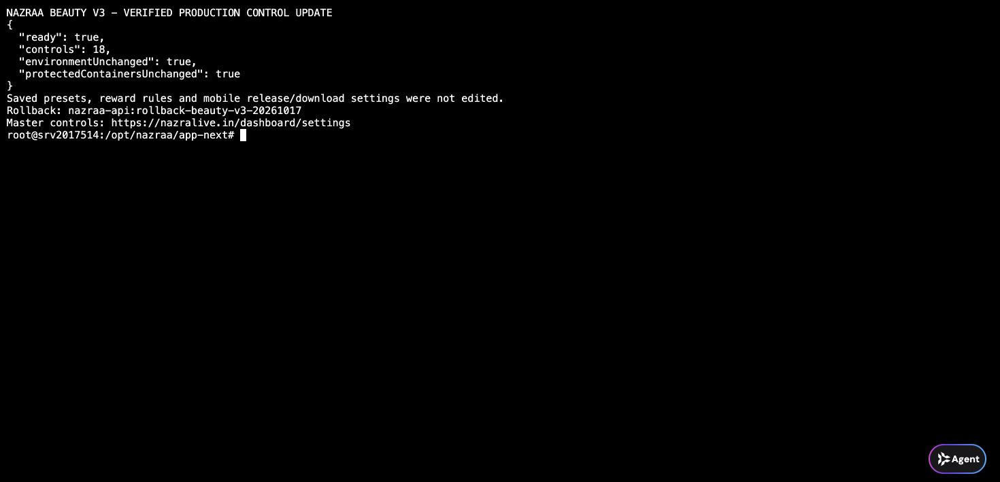

# Beauty V3 remote controls — 17 October 2026

Scope: extend the existing GPU beauty policy, not media/economy architecture.

`beauty-policy.ts` now allows 18 finite 0–100 controls, including the requested
geometry fields and `lowerFaceWidth`. Canonical `toneEvenness` / `relight`
accept old `toneLift` / `faceLight` values and return those aliases for older
APKs. Master Settings renders these controls from the existing shared registry.
The existing settings.manage + MASTER guard, change reason and audit transaction
remain unchanged. No arbitrary HTML or unrecognized fields are passed through.

Production deployment replaced only this baseline-verified source file:

- previous SHA-256: `8325438f34e0870d4b3a4988cf8aaaa3c543f175d17abf4dc769281268338897`
- new SHA-256: `8e916a48f8cd259d4d844593520c9641d6819a5ebe305028ec525cd095384df0`
- API candidate image: `sha256:56eac852d05d0f6dd3983352c702cea2e1ade337d81622cd2940d40e9d80d5f2`
- rollback image: `nazraa-api:rollback-beauty-v3-20261017`
- source backup / deployment proof: `/opt/nazraa/backups/beauty-v3-20261017/`

Next production image build passed; internal readiness returned ready. Runtime
environment key/value maps compare equal before/after. MySQL, Redis, realtime,
worker and Caddy container IDs remained unchanged; OCI LiveKit was not touched.
Saved tuning, current default strength, reward rules, versions and download
metadata were not edited. This deploy makes the controls available, but does
not forcibly publish new parameter values to existing Hosts.

The first deployment guard compared serialized environment arrays, found a
different ordering and automatically restored the old image. Inspection found
zero changed image-environment keys. A corrected order-independent key/value
comparison passed on activation. The guard still compares all values; no key
or secret was excluded and no environment values were printed.

Checks: canonical control/alias/bounds tests passed, TypeScript passed, scoped
ESLint passed, isolated core-mobile DB suite passed. Its initial long run let
an active Admin test fixture exceed the real two-minute presence TTL. Only the
isolated fixture heartbeat was refreshed before the Owner Exit assertion; the
production transfer rule was not changed. The complete rerun passed.

Mobile beauty/geometry and APK evidence is maintained in the mobile repository's
`docs/engineering/BEAUTY_GPU_V3_20261017.md`. Physical-phone image quality and
thermal/FPS testing must not be inferred from API readiness.
